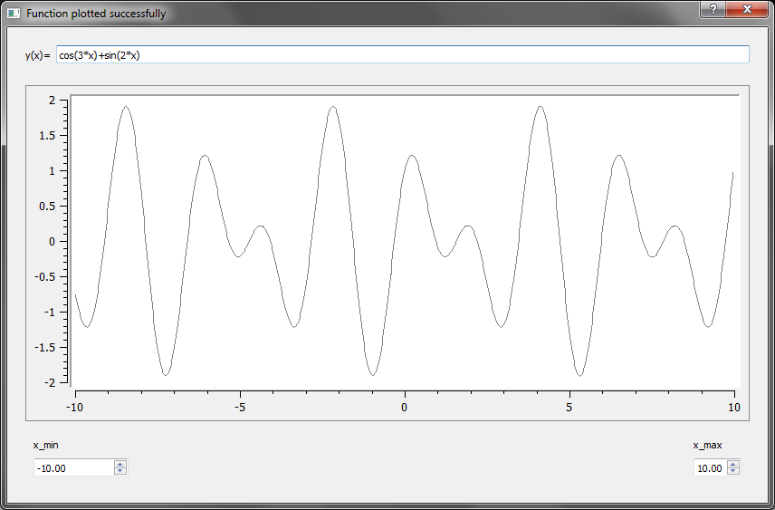

# FunctionPlotter

Plots a one-dimensional function.

FunctionPlotter is one of [Richèl Bilderbeek's tools](https://richelbilderbeek.github.io/tools/).

## Links

- [Source code](https://github.com/richelbilderbeek/FunctionPlotter)
- [Richèl Bilderbeek's tools](https://richelbilderbeek.github.io/tools/)
